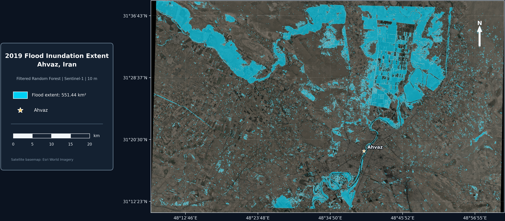
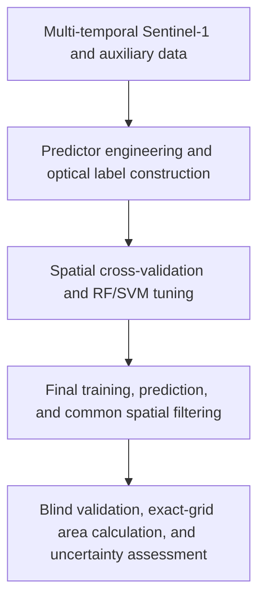
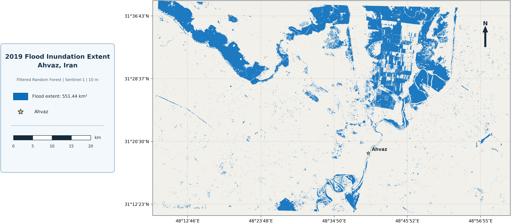
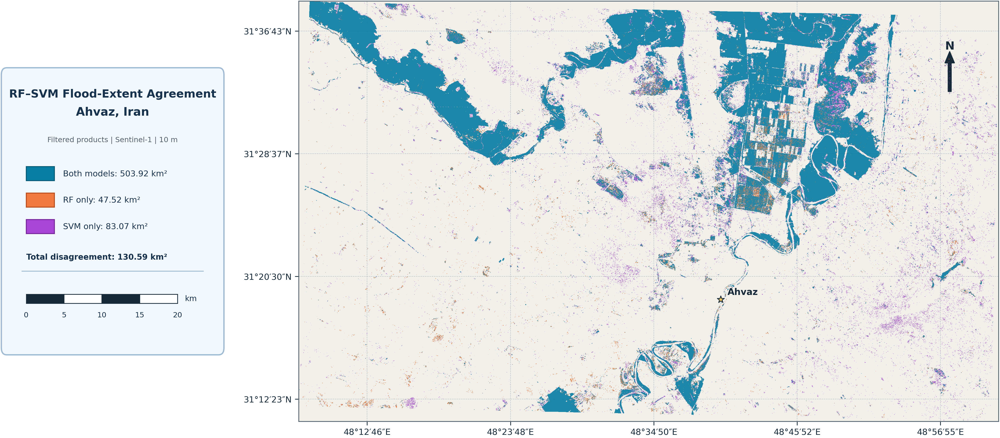

# Machine-Learning Flood Mapping and Spatial Uncertainty Assessment for Ahvaz, Iran

This repository provides a reproducible workflow for mapping the April 2019 flood around Ahvaz, Iran, from multi-temporal Sentinel-1 SAR observations. A physically interpretable threshold baseline is compared with tuned Random Forest (RF) and radial-basis-function support vector machine (RBF-SVM) classifiers. All products are evaluated against the same independent blind reference set, and agreement between the two machine-learning maps is assessed explicitly rather than inferred from aggregate accuracy alone.



## Project objective

The project addresses three questions:

1. Can multi-temporal Sentinel-1 VV and VH observations identify the 2019 flood more accurately than a fixed change-detection threshold?
2. How do tuned RF and RBF-SVM classifiers compare under spatially separated training and validation?
3. Do similar blind-validation scores correspond to spatially interchangeable flood maps?

The final answer to the third question is no. RF and filtered RBF-SVM achieved the same blind-sample metrics, but their mapped flood extents differed over **130.59 km²**.

## Main result

The **filtered Random Forest map** is retained as the primary flood product. On 238 independent binary reference samples, it achieved:

- **Overall accuracy:** 91.18%
- **Cohen's kappa:** 0.825
- **Flood precision:** 0.836
- **Flood recall:** 1.000
- **Flood F1:** 0.911
- **Mapped flood extent:** 551.44 km²

The filtered RBF-SVM achieved the same blind-sample scores but mapped 586.99 km². RF is selected as the primary product because it ties for the best blind F1, slightly outperforms the raw SVM result, and uses the simpler inference path. The filtered SVM map is retained as a **sensitivity product** for examining model-dependent spatial uncertainty.

## Data sources and their roles

| Dataset | Role in the workflow |
| --- | --- |
| Sentinel-1 GRD IW, VV and VH | Primary model predictors: baseline, pre-event, event, and post-event backscatter; temporal and polarization differences |
| Sentinel-2 SR Harmonized | Optical reference for constructing high-confidence training labels; not used as an RF or SVM predictor |
| Landsat 8 Collection 2 Level 2 | Supplements the event-date optical coverage used for training-label construction; not used as a model predictor |
| NASADEM | Elevation and derived slope predictors |
| JRC Global Surface Water | Historical water-occurrence predictor and permanent-water constraint |
| Copernicus Global Land Cover 2019 | Urban exclusion constraint applied during post-classification filtering |
| Manually reviewed blind samples | Independent final validation; never used for model training or hyperparameter selection |

Sentinel-2 from 27 March 2019 provided the pre-event optical reference. Sentinel-2 and Landsat 8 observations from 8 April 2019 were combined for the event reference. MNDWI-based rules identified stable dry areas, newly inundated water, and stable permanent water. These optical data were used **only to construct independent training labels**; the final RF and RBF-SVM predictions were produced from the 21-band Sentinel-1, terrain, and historical-water predictor stack.

## Workflow



The Sentinel-1 sequence uses descending relative orbit 108. The pre-event, event, and post-event scenes were acquired on 27 March, 8 April, and 20 April 2019. A historical median from April 2018 to March 2019 provides the baseline state. Predictor engineering includes original VV/VH backscatter, temporal backscatter changes, VV–VH differences, NASADEM elevation and slope, and JRC water occurrence.

A fixed set of 1,600 development samples was used for model training and spatial cross-validation. The final blind dataset contained 240 manually reviewed locations; two uncertain class-9 records were excluded, leaving **238 binary validation samples: 131 non-flood and 107 flood**.

## Models and spatial filtering

The final RF configuration uses 300 trees, three variables per split, a minimum leaf population of one, and a 0.50 bag fraction. The RBF-SVM uses gamma 0.03125 and cost 16. RF is applied to the ordered raw predictor stack, while RBF-SVM uses one consistent z-score transformation calculated from training-set means and standard deviations.

The same post-classification rules are applied to both models:

- exclusion of permanent water with JRC occurrence of at least 90%;
- exclusion of slopes above 10°;
- exclusion of mapped urban areas;
- removal of connected components smaller than eight pixels.

## Final verified results

| Product | TN | FP | FN | TP | Overall accuracy | Kappa | Flood precision | Flood recall | Flood F1 | Flood area (km²) |
| --- | ---: | ---: | ---: | ---: | ---: | ---: | ---: | ---: | ---: | ---: |
| Baseline threshold | 113 | 18 | 5 | 102 | 0.9034 | 0.8069 | 0.8500 | 0.9533 | 0.8987 | 262.7839 |
| Tuned RF raw | 110 | 21 | 0 | 107 | 0.9118 | 0.8249 | 0.8359 | 1.0000 | 0.9106 | 565.0642 |
| Tuned RBF-SVM raw | 109 | 22 | 0 | 107 | 0.9076 | 0.8167 | 0.8295 | 1.0000 | 0.9068 | 635.9270 |
| **Tuned RF filtered — primary** | **110** | **21** | **0** | **107** | **0.9118** | **0.8249** | **0.8359** | **1.0000** | **0.9106** | **551.4448** |
| Tuned RBF-SVM filtered — sensitivity | 110 | 21 | 0 | 107 | 0.9118 | 0.8249 | 0.8359 | 1.0000 | 0.9106 | 586.9872 |

## Primary scientific map

The scientific version below shows the selected filtered RF product on a neutral background for direct interpretation of the classified flood extent.



## Spatial agreement and model uncertainty

Equal sample-based scores do not imply equal spatial predictions. On the common exported 10 m grid:

- both models mapped 503.92 km² as flood;
- RF alone mapped 47.52 km² as flood;
- SVM alone mapped 83.07 km² as flood;
- total disagreement covered 130.59 km²;
- overall grid agreement was 97.03%;
- flood-union Jaccard similarity was 79.42%.



The separate SVM and satellite-overlay comparison maps remain available in [`results/maps`](results/maps) as supporting products, but are not treated as additional final maps.

## Technical challenges and quality control

| Challenge | Implemented control | Why it matters |
| --- | --- | --- |
| Cloud and coverage gaps in optical reference imagery | Combined Sentinel-2 and Landsat 8 event-date observations and required a common valid optical mask | Produces conservative, high-confidence training labels without adding optical bands to the SAR classifiers |
| Spatial leakage between model development and final evaluation | Removed a 300 m buffer around every blind location from the training domain | Keeps the final blind evaluation independent |
| Spatial autocorrelation in random validation splits | Used 5 km spatial blocks and five-fold spatial cross-validation for model selection | Provides a more realistic estimate of geographic transfer within the study area |
| Different preprocessing requirements for RF and RBF-SVM | Preserved raw predictors for RF and applied a single training-derived standardization to SVM | Prevents inference-time scaling mismatches and double standardization |
| Missing or masked predictors at validation locations | Audited every predictor band at every blind sample before calculating final metrics | Ensures that reported scores use the intended 238 binary samples |
| Area values sensitive to projection and reduction settings | Counted flood pixels on the exported 10 m EPSG:32639 GeoTIFF grid | Keeps reported areas consistent with the distributed raster product |
| Similar blind metrics but different mapped footprints | Added four-class RF–SVM agreement mapping, disagreement area, and Jaccard similarity | Makes model-dependent spatial uncertainty visible rather than hiding it behind one accuracy score |

The implementation history and resolved quality-control issues are documented in [`docs/report/REPRODUCIBILITY_AUDIT.md`](docs/report/REPRODUCIBILITY_AUDIT.md) and [`docs/report/RELEASE_VERIFICATION.md`](docs/report/RELEASE_VERIFICATION.md).

## Limitations

- The analysis represents one flood event and should not be interpreted as a universally calibrated flood model.
- Optical training labels remain sensitive to cloud masking, acquisition timing, mixed pixels, and MNDWI thresholds.
- The blind reference set contains 238 samples; it does not represent exhaustive field validation across the full floodplain.
- SAR flood detection can be affected by vegetation, surface roughness, urban double bounce, mixed land-water pixels, and acquisition geometry.
- The products map flood extent, not water depth, flow velocity, damage, or hazard.
- Post-classification masks improve physical plausibility but may remove genuine flooding in steep, urban, or historically wet locations.

## Project outputs

- Five-band 10 m GeoTIFF containing the baseline, raw RF, raw RBF-SVM, filtered RF, and filtered RBF-SVM products
- Independent blind-validation metrics, predictions, and confusion matrices
- Exact 10 m flood-area table aligned to the exported GeoTIFF grid
- Scientific and satellite-overlay maps for RF, RBF-SVM, and their spatial agreement
- Reproducibility audit, release verification record, and CV-ready project description

## Repository structure

```text
src/gee/             Google Earth Engine model and final export scripts
src/python/          Cartographic post-processing scripts
data/validation/     Blind labels, predictions, metrics, and model settings
results/maps/        Final scientific and satellite-overlay figures
results/tables/      Exact-grid flood-area results
docs/report/         Technical report sources and reproducibility records
docs/cv/             CV-ready project description
```

The canonical script is [`src/gee/ahvaz_rf_svm_pipeline.js`](src/gee/ahvaz_rf_svm_pipeline.js). It contains predictor construction, label generation, model tuning, final training, inference, blind validation, exact-grid area calculation, and all final export tasks.

## Reproducing the verified run

1. Upload the required training and blind-reference assets to the Earth Engine paths declared near the start of the canonical script.
2. Run `src/gee/ahvaz_rf_svm_pipeline.js` in the Google Earth Engine Code Editor.
3. Confirm that 238 binary blind samples are evaluated and that the confusion matrices match the table above.
4. Start the final export tasks for the five-band GeoTIFF, metrics, confusion matrices, blind predictions, model configuration, and exact flood areas.
5. Compare the exports with `CHECKSUMS.sha256` when an exact byte-for-byte release check is required.

The cartographic scripts and their basemap requirements are documented in [`src/python/README.md`](src/python/README.md).

## Reproducibility status

The corrected canonical script was rerun from a clean Earth Engine session on 16 November 2026. The run completed without a code error, evaluated all 238 binary blind samples, and reproduced every committed confusion-matrix cell. Flood areas were reconciled directly against the exported 10 m raster grid.

## Basemap attribution

The satellite-overlay figures use Esri World Imagery with attribution. Raw basemap tiles are not distributed in this repository.
